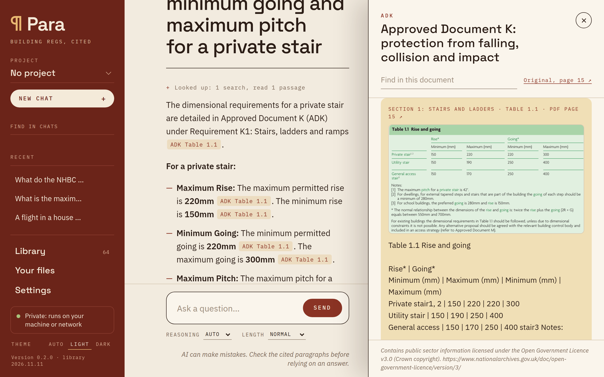

# Para

**Building regulations, cited.** · [pararegs.co.uk](https://pararegs.co.uk)

A free, open-source AI assistant for the building regulations in England that runs on your own computer. Ask it a question
("maximum travel distance from a flat entrance door in a single-stair block?") and it searches a library of the
Approved Documents, the Building Regulations 2010, the Building Safety Act and its guidance, reads the relevant
paragraphs, and answers with a link to each one, so you can check exactly where it came from.



- **Cites the paragraph.** Answers cite passages such as *ADB Vol 1 Table 3.1* or *BR 2010 reg 7*. Click one to
  open the document at that paragraph. The app checks every citation against what the AI actually looked up and
  removes any it made up.
- **Says what it couldn't check.** A citation made from a search extract without reading the passage is marked, and
  so is a figure that isn't in the passage cited for it. When the library is updated, old answers still open the
  right paragraphs, say which have been reworded since, and the Library lists what changed in the new edition.
- **Any engine you like.** Use an AI engine you already run: Ollama, LM Studio, Lemonade, llama.cpp, Jan, vLLM or
  any other OpenAI-compatible server, on this computer or your network. Or let the app download and run one itself
  (llama.cpp with a model suited to your computer's memory). Or use an online AI service (Anthropic, Mistral,
  OpenAI, OpenRouter or another) with your own API key.
- **Private.** With a local engine, your questions and files never leave your computer. The app shows whether
  it's private, and warns you when your engine is somewhere else, such as an online service.
- **Your own documents.** Add specifications, fire strategies, building control comments or manufacturers'
  guidance (PDF, Word, EPUB, HTML, text) and they're searched along with the library. The app asks you to confirm
  you're allowed to use each document this way first, because many publishers' licences (some British Standards,
  warranty providers' technical manuals) don't allow it.
- **Project notes.** Tell it about the project ("6-storey block of flats, top storey 17 m, sprinklered") and every
  answer takes it into account.
- **Kept up to date.** The library is rebuilt every week from gov.uk and legislation.gov.uk, and the app offers
  the new edition when the documents change.

## What's in the library

All Crown copyright, published under the [Open Government Licence v3.0](https://www.nationalarchives.gov.uk/doc/open-government-licence/version/3/),
which allows redistribution with attribution:

| | |
|---|---|
| Approved Documents | A, B (vol 1 and 2), C, D, E, F (vol 1 and 2), G, H, J, K, L (vol 1 and 2), M (vol 1 and 2), O, P, Q, R (vol 1 and 2), S, T, 7; current amendment booklets and corrections; the gov.uk FAQs; the Manual to the Building Regulations |
| Legislation (consolidated, from legislation.gov.uk) | Building Regulations 2010; Building Act 1984; Building Safety Act 2022; Building (Higher-Risk Buildings Procedures) (England) Regulations 2023; Higher-Risk Buildings (Descriptions and Supplementary Provisions) Regulations 2023; Regulatory Reform (Fire Safety) Order 2005; Fire Safety (England) Regulations 2022 |
| Government guidance (gov.uk) | Criteria for higher-risk buildings; building control approval, changes, completion certificates and transitional arrangements for higher-risk buildings; the golden thread; mandatory occurrence reporting; meeting building requirements (dutyholders); the Building Safety Act overview |

Diagrams and tables are included as images (about 600 of them), shown next to their paragraph in the reader, and
every passage from a PDF links to its page in the original.

The list is in [library/sources.json](library/sources.json). NHBC Standards, LABC Warranty's technical manual,
British Standards and similar are free to read online in some cases but are not licensed for redistribution or AI
use, so they're not included; if your licence allows it, add your copy under **Your files**.

The library covers **England**. Wales, Scotland and Northern Ireland have their own regulations.

## Install

**Mac** (Apple Silicon, macOS 12 or newer)
1. Download `Para-mac.zip` from the [latest release](../../releases/latest) and double-click it.
   Move **Para** to Applications.
2. The first time you open it, macOS says it can't verify the app (it isn't from the App Store). Open
   **System Settings › Privacy & Security**, scroll to the message about Para and click
   **Open Anyway**. You only do this once.

**Windows** (10 or 11, 64-bit)
1. Download `Para-windows-setup.exe` and double-click it. It installs for you alone (no administrator needed) and
   adds Para to the Start menu. If Windows SmartScreen appears, click **More info**, then **Run anyway**.
2. To remove it: **Settings › Apps**, Para, **Uninstall**. Your chats and settings are kept.

`Para-windows.zip` is the same app without an installer: extract it and run `Para.exe`.

**Linux** (x86-64: Ubuntu 22.04, Debian 12, Fedora 36 or newer)
- **Ubuntu, Debian, Mint, Pop!_OS:** download `Para-linux.deb`, double-click it and choose **Install** (or
  `sudo apt install ./Para-linux.deb`). Remove it from the software centre, or with `sudo apt remove para`.
- **Other distributions:** download `Para-linux.AppImage`, allow it to run (right-click, **Properties**, "Allow
  executing file as program", or `chmod +x Para-linux.AppImage`) and double-click it.
- `Para-linux.tar.gz` is the plain folder: extract it and run `Para/Para`, or `Para/install.sh` to add it to your
  applications menu (`install.sh --uninstall` removes it).

Para opens in its own window; if your system can't show one, it opens in your web browser instead.

**Updates.** Para checks once a day for a new version (Settings › Updates & about; nothing about you is sent).
Installed with the Windows installer, the Mac app, the .deb or the AppImage, it updates in one click with
**Update now**: it downloads the new version, checks it against GitHub's checksum and installs it. With the .deb,
your system asks for your password first. The Windows zip and the Linux folder link to the new release
instead.

**Then** choose an AI engine in the window that opens:
- **Use an engine I already run.** Click *Find engines on this computer*, or type the server's address
  (e.g. `http://127.0.0.1:11434/v1` for Ollama, `http://127.0.0.1:1234/v1` for LM Studio,
  `http://127.0.0.1:8000/api/v1` for Lemonade). Pick a model and press Save. Models with tool calling work best.
  Give the model room to read: Para's instructions and the passages it looks up need a context of 16,000
  tokens or more, and some engines start with far less and drop the beginning without saying so (Ollama's default
  is 4,096: raise *Context length* in its settings, or set `OLLAMA_CONTEXT_LENGTH=32768`).
- **Built-in engine.** The app suggests a model for your computer's memory, downloads llama.cpp and the model from
  Hugging Face, and runs them itself.
- **Use an online AI service.** Pick Anthropic, Mistral, OpenAI or OpenRouter (or type another service's
  address), paste your API key from that service, choose a model and press Save. Your questions, and passages from
  your own files, are sent to that company, so it isn't private.

**Which model the built-in engine suggests.** The app looks at your computer's memory and suggests the biggest
model that fits. Bigger models get more right:

| Your computer's memory | Suggested model | Download | Right, of our 36 test questions | Licence |
|---|---|---|---|---|
| 48 GB or more | NVIDIA Nemotron 3.5 Lightning 30B-A3B | 25.5 GB | 32 | OpenMDW 1.1 |
| 32 GB | Qwen3.5 35B-A3B | 22.2 GB | 33 | Apache 2.0 |
| 24 GB | gpt-oss 20B | 12.1 GB | 32 | Apache 2.0 |
| 16 GB | IBM Granite 4.2 8B | 5.3 GB | 35 | Apache 2.0 |
| 12 GB | Gemma 4 E4B | 5.0 GB | 22 | Apache 2.0 |
| 8 GB | Qwen3 4B Instruct 2507 | 2.5 GB | 20 to 25 | Apache 2.0 |

Granite is small and got the most right, but it is slow: it reasons before it answers, about a minute an answer on
a fast computer and longer on a laptop. You can pick it on a bigger computer too, or Gemma on a 16 GB one if you'd
rather have quicker answers and check them more.

The two smallest get about one question in three wrong. Gemma mostly fails by saying it can't find something that
is in the library; the 4B sometimes gives a figure from memory. With either, open each cited paragraph before you
rely on the answer: the app marks citations the AI didn't read in full and figures the cited paragraph doesn't
hold. The questions and every model's results are in [docs/model-tests.md](docs/model-tests.md).

The model list ([para/models.json](para/models.json)) is also published with each release, so installed
copies pick up better models without reinstalling.

## Share it with a team

To run one copy for everyone in an office, start it on a machine that can reach your AI engine:

```bash
python3 -m para --host 0.0.0.0 --port 8085
```

and open `http://<that-machine>:8085` in a browser. Anyone who can reach that port can use it and change its
settings, so only do this on a trusted network.

## Run from source

```bash
pip install pypdf pywebview truststore   # pywebview and truststore are optional
python3 -m para                       # in its own window (or the browser without pywebview)
python3 -m para --browser             # in your browser
```

Without a built library the app offers to download the latest one. To build it yourself (needs `pdftotext` and `pdftoppm` from
poppler-utils):

```bash
python3 library/build.py                 # library/dist/regs.sqlite, from gov.uk and legislation.gov.uk
python3 library/build.py --release       # also regs.sqlite.gz and library.json for a release
```

Tests run against a stand-in model, with no engine or library download needed:

```bash
python3 tests/test_app.py
```

## How it works

```
question ─► AI model (any OpenAI-compatible server) ─► search_library ─► SQLite FTS5 index ─► passages
                ▲                                       read_passage   ─► paragraphs in full
                └──── answer citing [r1234] ◄───────────┘ show_passage  ─► opens the reader
```

- `library/build.py` downloads the documents (gov.uk content API, legislation.gov.uk XML), splits them at their
  own paragraph numbers ("2.13", "Table 3.1", "reg 7"), keeps table rows together, repairs ligatures lost in PDF
  extraction, and indexes them with SQLite FTS5.
- `para/core.py` runs each question: the model searches and reads with tools, then answers citing passage ids.
  Citations to passages it never saw are removed. Models without tool support get the best passages attached to
  the question instead.
- `para/llm.py` talks to any OpenAI-compatible `/chat/completions` endpoint, including reasoning output from
  servers that stream it.
- `para/engine.py` installs and runs the built-in engine (llama.cpp's `llama-server`).
- `para/myfiles.py` reads your own files into a separate index in the app's data folder.
- `para/server.py` serves the page on 127.0.0.1 and opens it in a window (pywebview).
- `para/updater.py` updates the app itself, in the way it was installed.
- Releases are built by [.github/workflows/release.yml](.github/workflows/release.yml): push a tag like `v0.1.0`.

Your settings, chats and the index of your files are kept in `~/Library/Application Support/Para`
(Mac), `%LOCALAPPDATA%\Para` (Windows) or `~/.local/share/para` (Linux). Your
files themselves are in `~/Para Files`.

A personal open-source project by [Tomás Val](https://github.com/valtomas), inspired by
[Survival LLM](https://github.com/anonnerdfrenzy/survival-llm). Contributions welcome: see [AGENTS.md](AGENTS.md) for
how the code fits together and [DESIGN.md](DESIGN.md) for the interface.

## Licence

Para is free software: you can redistribute it and/or modify it under the terms of the
[GNU Affero General Public License](LICENSE) as published by the Free Software Foundation, either version 3 of the
License, or (at your option) any later version. Copyright (C) 2026 Tomás Val. It comes with no warranty.

In short: use it, share it and change it freely. If you distribute a changed version, or run one as a service for
other people, you must publish your changes under the same licence.

- Library content: Crown copyright, [Open Government Licence v3.0](https://www.nationalarchives.gov.uk/doc/open-government-licence/version/3/).
- Fonts in `para/static/fonts/`: SIL Open Font License.
- Contributions: see [CONTRIBUTING.md](CONTRIBUTING.md).

AI makes mistakes. Every answer shows its sources so you can check them against the documents. This is not a
substitute for professional judgement or for building control approval.
